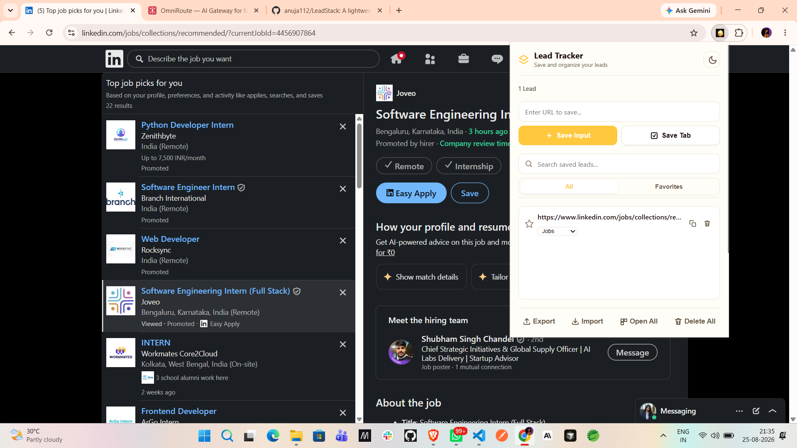
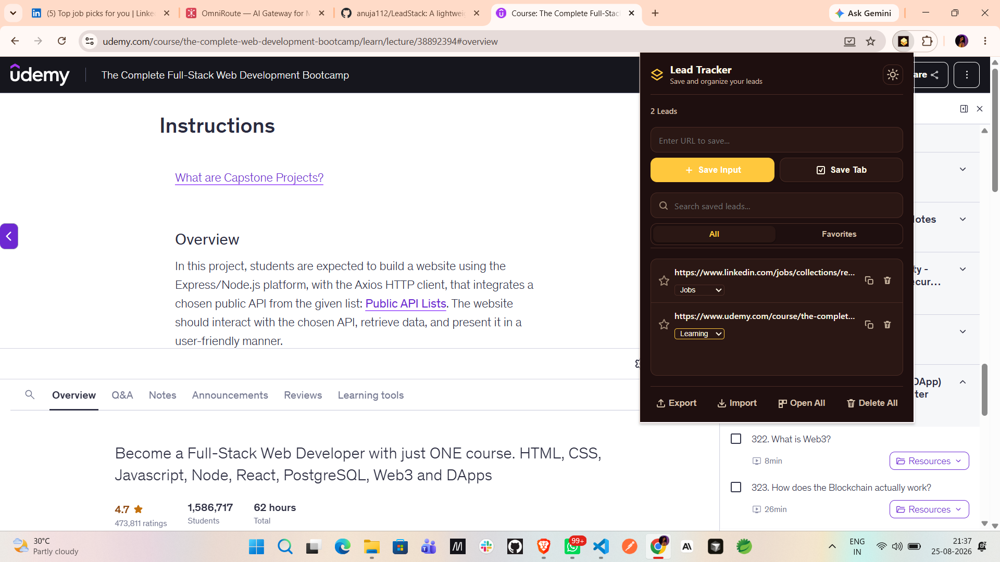

# LeadStack 🚀

LeadStack is a modern, lightweight Chrome extension designed to help you capture, categorize, and organize your web leads directly from your browser. Whether you are job hunting, doing sales prospecting, researching, or compiling resources, LeadStack keeps your critical links structured and accessible.

---

## 📸 Screenshots

<table>
  <tr>
    <td>
      <p align="center"><b>Light Mode</b></p>
      <!-- Add your light mode screenshot path below, e.g., assets/light-mode.png -->
      
    </td>
    <td>
      <p align="center"><b>Dark Mode</b></p>
      <!-- Add your dark mode screenshot path below, e.g., assets/dark-mode.png -->
      
    </td>
  </tr>
</table>

*(Replace the placeholder URLs above with your actual screenshot images once available)*

---

## ✨ Features

- 💾 **Quick Save**:
  - **Save Tab**: Instantly save your active browser tab's URL with a single click.
  - **Save Input**: Manually type or paste a custom URL.
- 🏷️ **Categorization & Tags**: Assign predefined tags (`Jobs`, `Clients`, `Research`, `Learning`, `Important`) inline to categorize each lead immediately.
- ⭐ **Favorites**: Star your most important leads to prioritize them, and filter your list to show only your starred entries.
- 🔍 **Real-Time Search**: Search and filter your saved leads dynamically as you type.
- 🌓 **Dark & Light Mode**: Toggle themes to suit your interface preferences.
- ⚡ **Bulk Actions**:
  - **Copy URL**: Copy individual lead links to clipboard in one tap.
  - **Undo Deletion**: Accidentally deleted a lead? Restore it instantly using the temporary Undo toast action.
  - **Open All**: Open all leads (or your currently filtered search/favorites list) simultaneously in new browser tabs.
  - **Delete All**: Clean your workspace with a double-click safeguard.
- 📤 **Data Portability (Import/Export)**:
  - **Export**: Backup your leads into a downloadable JSON file.
  - **Import**: Merge existing leads from other devices or backups (supports legacy plain array formats and standard LeadStack JSON structures without duplicates).

---

## 🛠️ Installation Guide

Follow these steps to run LeadStack locally in your Chrome browser:

1. **Download/Clone the Repository**:
   - Clone this repository to your local machine:
     ```bash
     git clone https://github.com/anuja112/LeadStack.git
     ```
   - *Or download the repository source code zip file and extract it.*

2. **Open Extensions Management in Chrome**:
   - In Google Chrome, navigate to `chrome://extensions/` by typing it directly in the URL bar.
   - Alternatively, click the Chrome menu (three dots) -> **Extensions** -> **Manage Extensions**.

3. **Enable Developer Mode**:
   - Toggle the **Developer mode** switch in the top-right corner of the Extensions page.

4. **Load the Extension**:
   - Click the **Load unpacked** button in the top-left corner.
   - Select the folder containing this project's files (where the `manifest.json` file is located).

5. **Pin LeadStack for Quick Access**:
   - Click the puzzle piece icon (Extensions) in your Chrome toolbar, find **LeadStack**, and click the pin icon.

---

## 📂 Project Structure

```text
LeadStack/
├── manifest.json       # extension metadata, permissions & configuration (Manifest V3)
├── index.html          # popup interface markup
├── index.css           # modern visual styles & theme utility variables
├── index.js            # lead management logic, DOM events & localStorage handlers
├── icons/              # extension icon assets
│   ├── icon16.png
│   ├── icon32.png
│   ├── icon48.png
│   └── icon128.png
├── LICENSE             # MIT License terms
└── README.md           # project documentation
```

---

## 🤖 Tech Stack

- **HTML5** & semantic markup.
- **CSS3** with custom variables (CSS variables) for light/dark themes.
- **Vanilla JavaScript** (ES6+) for lean performance, DOM manipulation, storage persistence, and file handling.
- **Chrome Extension APIs** (supports `chrome.tabs` and Manifest V3).

---

## 📄 License

This project is licensed under the MIT License - see the [LICENSE](LICENSE) file for details.

---

*Created with ❤️ by [Anuja Ghosal](https://github.com/anuja112)*
